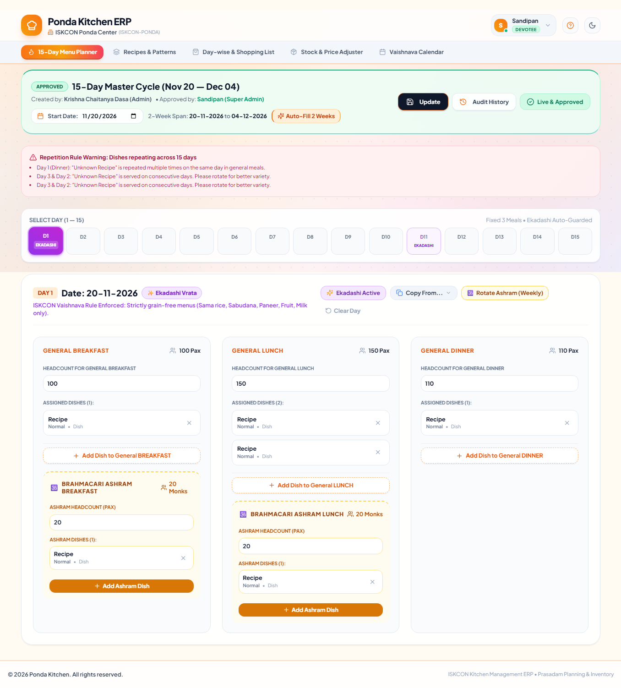
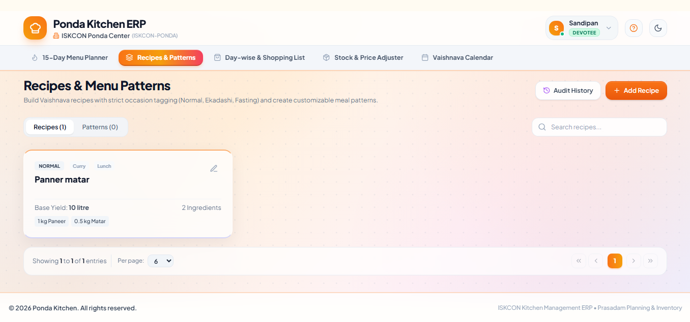
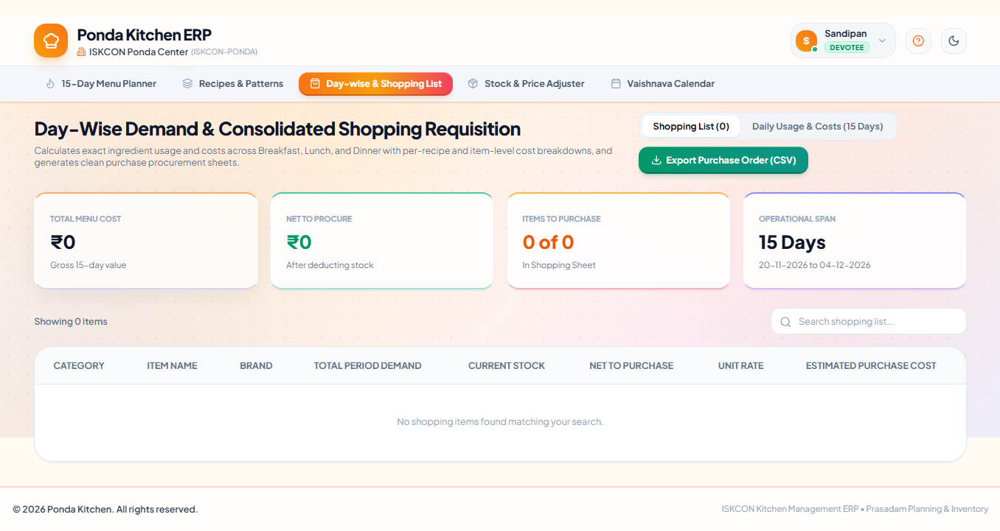
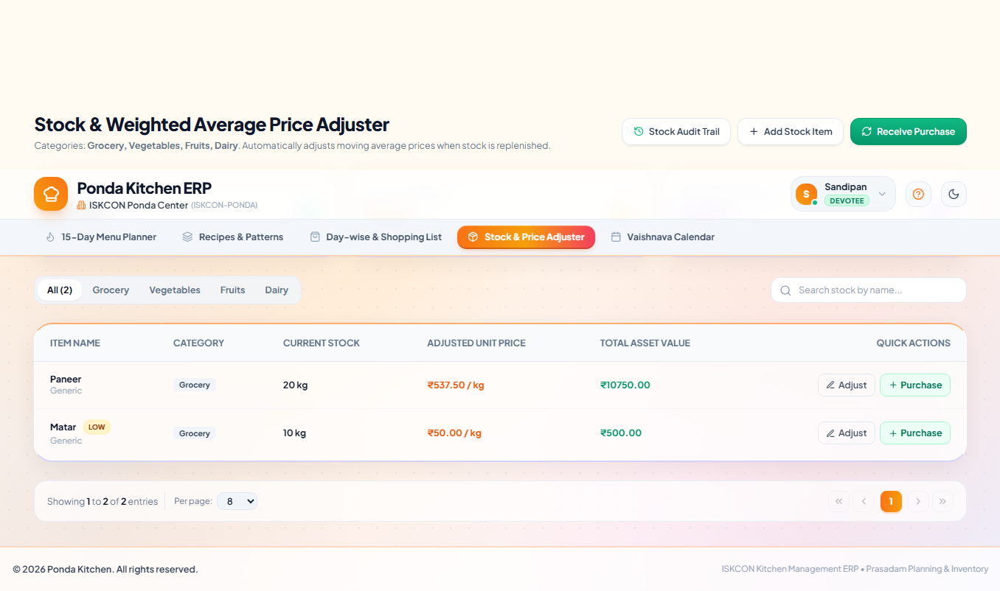
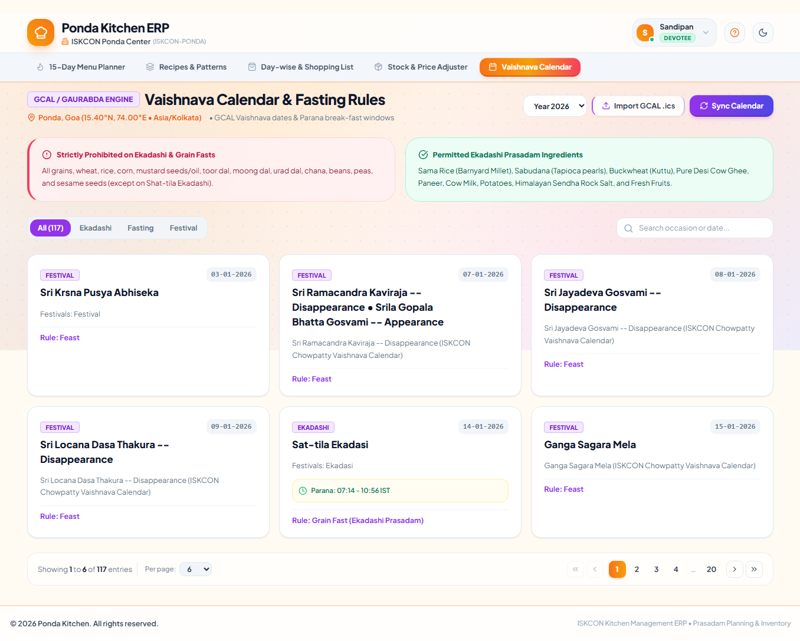

# Ponda Kitchen ERP — ISKCON Kitchen Management System

A modern, easy-to-use **Kitchen Management & Prasadam Planning ERP** built for **ISKCON Centers & Temples**. It helps devotees, storekeepers, and temple admins plan 15-day menus, manage recipes and stock, respect Vaishnava fasting rules, and track daily & monthly kitchen costs—on desktop, Android, and iOS (PWA).

**Live App:** https://iskcon-ponda-kitchen-erp.web.app

---

## Screen-by-Screen Guide & Functionality

> **Screenshots Note:** Add captured screenshots of each screen to `docs/screenshots/` (e.g., `login.png`, `menu-planner.png`, `recipes-patterns.png`, `shopping-list.png`, `stock.png`, `calendar.png`, `admin-analytics.png`, `sadmin-report.png`) to display them inline below.

### 1. Sign In, Registration & Center Selection

- **Sign In**: Log in with Email & Password or **Continue with Google**.
- **New Registration (Email Verification)**: New email signups receive a verification email valid for **15 minutes**. Once the link is clicked, registration is completed and you are redirected to Sign In.
- **Google Onboarding**: First-time Google users are guided to **Choose Your Kitchen Center** before entering the dashboard.
- **Session Protection**: Sessions last **30 minutes** with a **5-minute warning popup** allowing you to extend your session by another 30 minutes with one click.

---

### 2. 15-Day Menu Planner

- **2-Week Auto-Fill**: Pick a **Start Date** and the planner automatically calculates the 15-day span and fills in menus across Breakfast, Lunch, Dinner, and Brahmacari Ashram meals.
- **Ekadashi Guard**: Automatically detects Ekadashi days from the Vaishnava Calendar and blocks non-Ekadashi grain/pulse dishes.
- **Brahmacari Ashram Rotation**: One-click **Auto-Rotate Ashram** applies a 7-day weekly rotation for Ashram meals.
- **Save & Maker-Checker Approval**: Edit freely in draft mode, then click **Update** to save to Firestore and record the change in the **Audit History**. Admins can approve menus created by devotees or other admins.

---

### 3. Recipes & Meal Patterns

- **Create & Edit Recipes**: Add or update recipes with Occasion (`Normal`, `Ekadashi`, `Fasting`), Meal Slot, Dish Type, and **Base Yield & Unit** (`per person`, `piece`, `litre`, `kg`).
- **Works Without Pre-Existing Stock**: You can add any ingredient—even if your center has zero stock yet. Custom ingredients are automatically added to Stock with `0` quantity so your shopping list stays accurate.
- **Create & Edit Meal Patterns**: Group multiple recipes into reusable Meal Patterns (e.g., *Classic Raj Bhog Lunch*) for quick menu planning.

---

### 4. Day-Wise Demand & Shopping List

- **Daily Usage & Costs**: See exact ingredient quantities and ₹ costs day-by-day across all 15 days.
- **Consolidated Shopping List**: Automatically totals 15-day ingredient demand, **subtracts your current stock**, and shows only the net quantities you need to buy.
- **One-Click CSV Export**: Download a clean Purchase Order spreadsheet for storekeepers.

---

### 5. Stock & Weighted Average Price Adjuster

- **KPI Summary Strip**: At-a-glance cards for **Total Inventory Value (₹)**, **Low / Out-of-Stock Items** (click to filter), and **Missing Unit Price (₹0)** (click to filter).
- **Quick Row Actions**:
  - **Adjust**: Inline-edit stock counts or unit prices right on the row/card.
  - **Purchase**: Pre-selects the item and previews the **Purchase Total**, **New Stock Balance**, and **New Moving Weighted Average Price** live before saving.
- **Moving Weighted Average Formula**:
  $$\text{New Unit Price} = \frac{(\text{OldStock} \times \text{EffectiveOldPrice}) + (\text{PurchasedQty} \times \text{PurchasedUnitPrice})}{\text{OldStock} + \text{PurchasedQty}}$$
  *(If `OldPrice` is `₹0`, it uses `PurchasedUnitPrice` so placeholder items don't dilute the average.)*

---

### 6. Vaishnava Calendar

- **GCAL / Gaurabda Engine**: Powered by the ISKCON Chowpatty GCAL dataset (2025–2030) with Gaurabda astronomical fallback for other years.
- **Focused Observances**: Shows **Ekadashi** (with Parana break-fast windows), **Vaishnava Acharya appearances/disappearances**, and **major Vaishnava festivals** (excluding Masik Shivaratri).
- **Custom `.ics` Import**: Upload `.ics` files from GCAL or vaisnavacalendar.info if needed.

---

### 7. Center Admin Dashboard (Analytics & Devotees)

- **Monthly & Previous-Days Cost Analytics**: Filter by **Month**, **Yesterday**, **Last 7 Days**, **Last 15 Days**, or **Pick Date** to inspect Menu Cost, Stock Purchase Spend, Avg Daily Cost, Cost/Plate, and Inventory Value by Category—with CSV export.
- **Devotee Management**: Promote devotees to Center Admin or demote them, and raise requests for new centers.

---

### 8. Super Admin Console (SAdmin HQ)

- **Center-Wise Report**: Compare 15-day menu costs, net procurement, stock asset value, workforce, and color-coded **Plan Status** (`approved`, `pending approval`, `rejected`, `draft`) across every ISKCON center—with stacked mobile cards and CSV export.
- **Governance**: Approve/reject new center requests, activate/pause centers, and switch between centers from the top bar.

---

### 9. First-Time Guided Tour & PWA Install
- **Interactive Guided Tour**: Automatically launches on a new user's first login and walks through every tab. Replay anytime via the **`?`** button in the header.
- **Installable App (PWA)**: Install directly from Chrome (Android/Desktop) or Safari (iOS → *Add to Home Screen*) for a full-screen app experience.
- **Day / Night Theme & Accessibility**: Instant light/dark mode toggle, and all modals close cleanly with **Escape** or **clicking outside**.

---

## Roles & Permissions Summary

| Role | What They Can Do |
|---|---|
| **Devotee (`user`)** | Plan 15-day menus, create/edit recipes & patterns, view shopping lists & stock, view Vaishnava calendar. |
| **Center Admin (`admin`)** | Everything a Devotee can do + approve center menus (Maker-Checker), manage stock purchases/counts, view Monthly/Daily Cost Analytics, manage center devotees, request new centers. |
| **Super Admin (`sadmin`)** | Global oversight across all centers, Center-Wise Financial Reports, approve/pause/delete centers, manage global admins. |

---

## Local Setup & Deployment

### Prerequisites
- Node.js 18+ and a Firebase project (Auth + Firestore + Hosting) configured in `.env`.

### Run Locally
```powershell
npm install
npm run dev
```
Open `http://localhost:3000`.

### Build & Deploy to Firebase
```powershell
npm run build ; npx --yes firebase-tools deploy --only hosting
```
To also deploy updated Firestore security rules:
```powershell
npm run build ; npx --yes firebase-tools deploy --only hosting,firestore:rules
```
